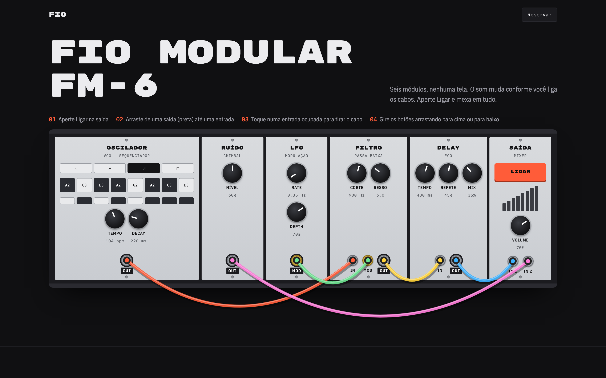
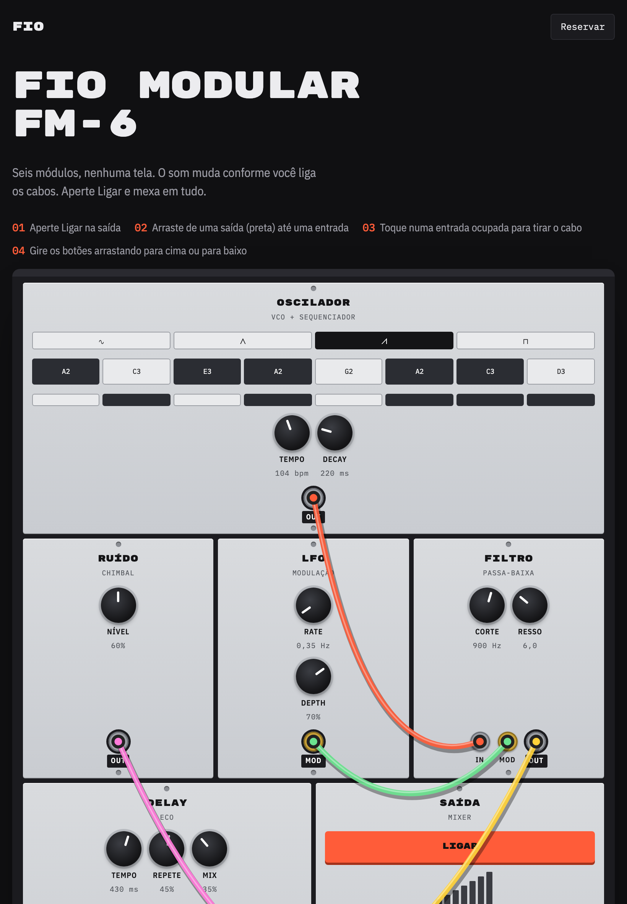
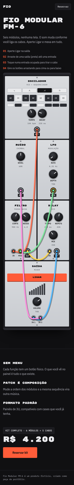

# Fio Modular FM-6

Página de produto de um sintetizador modular fictício. Seis módulos, nenhuma tela: você liga os cabos arrastando, gira os botões e ouve o resultado na hora, direto no navegador.



<p align="center">
  
  &nbsp;
  
</p>

## O que dá pra fazer

- **Ligar e desligar** o som pelo botão do módulo Saída
- **Ligar cabos** arrastando de uma saída (etiqueta preta) até uma entrada; os cabos têm física e balançam
- **Tirar cabos** tocando numa entrada ocupada e soltando fora
- **Girar botões** arrastando para cima ou para baixo (ou com as setas do teclado)
- **Editar a sequência**: ligar e desligar notas e o chimbal passo a passo, trocar a forma de onda

Funciona com mouse e toque, em qualquer tamanho de tela: em telas largas o rack fica numa linha; no tablet e no celular os módulos se reorganizam em grade.

## Tecnologias

| Tecnologia                                                                   | Uso                                                      |
| ---------------------------------------------------------------------------- | -------------------------------------------------------- |
| [Next.js 16](https://nextjs.org) (App Router)                                | framework, renderização estática e fontes                |
| [React 19](https://react.dev) + [TypeScript](https://www.typescriptlang.org) | interface e tipagem                                      |
| [Tailwind CSS 4](https://tailwindcss.com)                                    | estilos e layout responsivo                              |
| [Motion](https://motion.dev)                                                 | animações de entrada, scroll e interação                 |
| [Tone.js](https://tonejs.github.io)                                          | síntese de áudio (carregado só quando você aperta Ligar) |
| [Playwright](https://playwright.dev)                                         | geração dos prints deste README                          |
| ESLint + Prettier                                                            | padrão de código e formatação                            |

## Como rodar

Precisa de [Node.js](https://nodejs.org) 22 ou mais recente.

```bash
npm install
npm run dev
```

Abra http://localhost:3000. Para testar no celular na mesma rede Wi-Fi, rode `npm run dev -- -H 0.0.0.0` e acesse `http://<ip-do-seu-computador>:3000`.

### Comandos

| Comando               | O que faz                                                                                       |
| --------------------- | ----------------------------------------------------------------------------------------------- |
| `npm run dev`         | servidor de desenvolvimento                                                                     |
| `npm run build`       | verifica os tipos e gera a versão de produção                                                   |
| `npm run start`       | serve a versão de produção (depois do build)                                                    |
| `npm run lint`        | ESLint                                                                                          |
| `npm run format`      | Prettier em todo o projeto                                                                      |
| `npm run check`       | testa as regras de conexão dos cabos                                                            |
| `npm run screenshots` | gera os prints em `docs/` (depois do build; na primeira vez, `npx playwright install chromium`) |

## Estrutura

```
src/
├── app/                   layout, página e estilos globais (Next.js)
├── domain/                regras do produto, sem React
│   ├── synth.ts           parâmetros, formatos de exibição e sequência
│   └── patch.ts           entradas, saídas e o que pode ligar em quê
├── services/audio/        AudioEngine: traduz o estado do painel para o Tone.js
├── hooks/useSynth.ts      estado do sintetizador e ciclo de vida do áudio
├── lib/                   física dos cabos (rope.ts) e utilitário cn
├── providers/             contextos do rack e configuração do Motion
├── components/
│   ├── atoms/             Knob, Jack
│   └── organisms/         Header, Hero, Rack, Features, Buy, Footer
└── constants/             curvas de animação
```

Imports usam aliases: `@atoms/*`, `@organisms/*`, `@domain/*`, `@services/*`, `@hooks/*`, `@providers/*`, `@lib/*`, `@constants/*`.

---

Produto fictício, criado como peça de portfólio.
